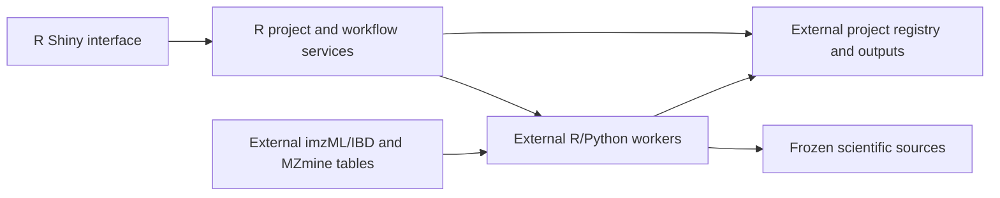

# Architecture

FullPixel MSI Quant 1.1.0 separates user interaction, orchestration, scientific
execution, and persisted project state.

## Main layers

### Shiny interface

`app/app.R` and `R/shiny_*` provide project creation, file registration,
validation, workflow control, progress, artifact browsing, and results
downloads.

### Application and workflow services

Files under `R/` implement project manifests, configuration, dataset
registration, scientific-profile checks, run state, artifacts, provenance,
worker dispatch, workflow orchestration, and workbook validation.

### External workers and adapters

Files under `tools/` execute scientific stages outside the Shiny session.
Separate adapters support the reference workflow, generic two-group workflow,
quantify-only workflow, and multi-group workflow.

### Frozen scientific core

`validated-source/` contains four byte-registered reference scripts. Their
hashes are verified before scientific execution. Normal application code may
orchestrate these scripts but must not modify them.

### External project state

Raw data, project manifests, logs, workspaces, intermediate artifacts, and
results remain outside the source repository in user-selected project folders.

## Design rules

- repository paths are portable and relative;
- external scientific inputs are explicitly registered;
- no silent newest-file discovery;
- stage outputs are immutable artifacts;
- retries preserve failed-attempt provenance;
- missing values remain missing;
- no pseudocount, imputation, pairing, or p-values;
- annotation integration preserves quantitative values;
- final workbooks must pass their mode-specific contract.
